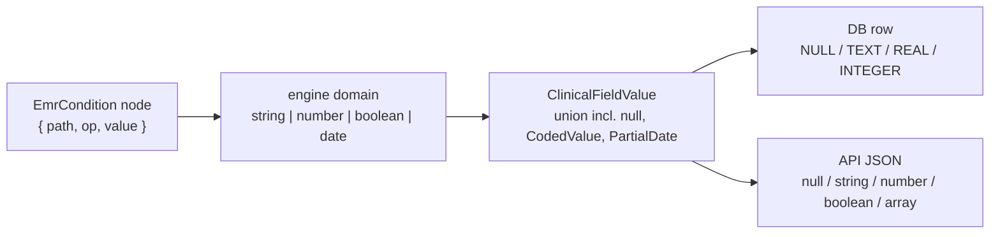

# Value coercion reference

How values change shape across the four layers: **condition/calculation engine**
(borrowed ODK semantics), **TS runtime** (`ClinicalFieldValue`), **DB write**, and
**API JSON**. The engine owns rules 1–3; the persistence boundary owns rule 4. Every
conversion is total — no thrown errors, unknown → documented fallback.

## The value tiers



## 1. Blanks and missing values (tri-state, preserved in memory)

| State | Engine reads as | Meaning | Notes |
|---|---|---|---|
| absent node | `''` (empty string) | never answered / not applicable | no key in instance map |
| `''` | `''` | asked, left blank | typed-but-empty |
| `null` | `''` | explicitly no value | JS `null` coerces to `''` at read |

Rationale: ODK has no `null` — empty node = `''`. We keep `null` in the TS union for
API ergonomics but the engine never sees it: **at engine entry, `null` → `''`**.

Numeric context: `toNumber('')` → `NaN` (ODK rule). Consequence: `'' = ''` is **true**
(string compare), but `'' > 5`, `'' >= 40` are **false** (NaN comparisons are false),
and `'' != 3` is **true** — blank satisfies `!=` constraints. This matches ODK and is
pinned by golden tests.

## 2. Scalar coercions (engine domain — replicating ODK)

| To ↓ / From → | `''`/null | string | number | boolean | date |
|---|---|---|---|---|---|
| **number** | `NaN` | `Number(s)`; `Infinity`/non-numeric → `NaN`; `''` → `NaN` | identity | `true→1`, `false→0` | ms since epoch |
| **string** | `''` | identity | integer → no decimal point (`'40'`); non-integer → `'40.5'`; `NaN → 'NaN'` (display-only guard) | `'true'` / `'false'` | ISO `8601` string |
| **boolean** | `''` (NaN-like, not `false`) | `''→''`; `'false'`,`'0'` → `false`; any other non-empty → `true` | `0→false`, else `true`; `NaN→false` | identity | `true` |
| **date** | invalid | parse ISO `YYYY-MM-DD` or `YYYY-MM-DDThh:mm[:ss]`; else invalid | ms → date | invalid | identity |

Comparison semantics (`=`, `!=`, `<`, `<=`, `>`, `>=`):
- both sides coercible to number → numeric compare; else string compare (case-sensitive).
- any `NaN` operand → comparison is `false` (except `!=`, which is `true`).
- `and`/`or` use `toBoolean`; `''` is falsy-but-not-false — `'a' = ''` is `false`,
  `not('')` is `true`.

## 3. Compound runtime types (`ClinicalFieldValue`)

| Type | Engine representation | In conditions |
|---|---|---|
| multiselect | **space-delimited string** (`'1 3'`) — engine wire form | `includesValue(f,'3')`, `selectedAt(f,0)`, `countSelected(f)` |
| select (single) | the option `value` string | comparison node, e.g. `{ path: ['clinic'], op: '=', value: 0 }` |
| `EmrCodedValue` | its `code` string | compares by code; `labelOf` maps code → `presentation.options` label |
| `ClinicalQuantityValue` | its numeric `value` | numeric coercion uses the magnitude, unit ignored by logic |
| `EmrPartialDate` | its `value` string (`YYYY` / `YYYY-MM`) | date functions on partial dates are invalid → treated as `''`; never guessed to full date |

## 4. Dates and time

- Canonical storage shape: **ISO 8601 string** (`YYYY-MM-DD`, or full datetime with
  `T` + offset). No `Date` objects cross a boundary — engine, DB, and API all see strings.
- Date arithmetic is out of scope in v1; `formatDate` and comparisons only.
- `today()` / `now()` read an **injected clock** (`LogicEnv.clock`) — deterministic
  tests, no hidden `Date.now()` in the engine.
- `EmrPartialDate` never auto-completes: a `YYYY` value fails `formatDate` with day
  precision and returns `''`.

## 5. Persistence boundary (DB + API)

Normalization on write (single function, `toPersistent(value)`):

| In memory | DB column | API JSON |
|---|---|---|
| `null` | `NULL` | `null` |
| `''` | `NULL` | `null` |
| `NaN` | `NULL` (never persisted) | `null` |
| number | `REAL` (or `INTEGER` when `Number.isInteger`) | JSON number |
| boolean | `INTEGER` 0/1 | JSON boolean |
| multiselect | `TEXT` `'1 3'` (space-delimited, canonical order = entry order) | `["1","3"]` array |
| date/datetime | `TEXT` ISO 8601 (UTC offset normalized to `Z` for datetimes) | ISO string |
| `EmrCodedValue` | code in value column + system/code/display columns per terminology binding | object `{system, code, display}` |
| `EmrPartialDate` | `TEXT` as authored + `precision` column | `{value, precision}` |

Rules:
- **Blank collapses at rest.** `''` and `null` both persist as `NULL`. The tri-state
  lives only in the running session; at rest there is one "no value". Round-trip
  restores absent → engine-reads-`''`, so condition semantics are unaffected.
- **`NaN` is a compute artifact, not data.** If a calculation yields `NaN` at save
  time, the field persists `NULL` and the UI keeps showing the constraint message —
  never the string `'NaN'`.
- **SQLite (Expo, `expo-sqlite`)** stores per the table above; booleans as 0/1 is a
  read/write adapter concern, not a model concern.
- **API** consumes/produces JSON per the table; multiselect arrays are joined to the
  space-delimited string at engine entry (`fromPersistent`), so `selected()` semantics
  hold regardless of transport shape.
- `fromPersistent(toPersistent(v))` must reproduce engine-equivalent values for every
  type above — pinned by round-trip property tests (the same guarantee
  `field-contract.spec.ts` already enforces for definitions).

## 6. Where the conversions live

```
emr-controller/src/logic/
  coerce.ts      toNumber / toBoolean / toString / toDate + comparison dispatch
  instance.ts    null → '' at read; persistent → engine shapes (multiselect join)
  logic-port.ts  injected clock (LogicEnv.clock)
persistence (per host app)
  vcms / EMR api    toPersistent / fromPersistent — the only writers of NULL
```

One implementation each; no layer re-implements a coercion it receives from a lower
layer.
